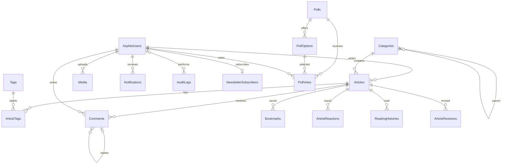

# Database design

SQL Server / EF Core Code First. Migration `InitialCreate` tạo schema; không dùng EnsureCreated.
Nguồn chính xác các cột, độ dài, nullable và indexes: `NewsPortal.Api/Models/Entities.cs`,
`NewsPortal.Api/Data/ApplicationDbContext.cs`, `NewsPortal.Api/Migrations/*InitialCreate.cs`.

| Bảng | Khóa chính | Khóa ngoại / ràng buộc |
|---|---|---|
| AspNetUsers | Id (string) | Identity, FullName, Bio, AvatarUrl, IsActive, timestamps |
| AspNetRoles/UserRoles/Claims/Logins/Tokens | Identity standard | Identity relationships |
| Categories | Id | ParentId → Categories; Slug unique |
| Articles | Id | CategoryId, AuthorId, EditorId; Slug unique; RowVersion concurrency |
| Tags | Id | Slug unique |
| ArticleTags | ArticleId + TagId | N-N Articles/Tags |
| Comments | Id | ArticleId, UserId, ParentCommentId; moderation status |
| ArticleReactions | Id | ArticleId + UserId unique; ReactionType |
| Bookmarks | Id | ArticleId + UserId unique |
| ReadingHistories | Id | ArticleId + UserId unique; ReadAt |
| Media | Id | UploadedBy → AspNetUsers; file metadata |
| ArticleRevisions | Id | ArticleId, ChangedBy → AspNetUsers; snapshot |
| Notifications | Id | UserId; IsRead |
| AuditLogs | Id | nullable UserId; action, entity, timestamp |
| SiteSettings | Key | Value |

Xóa user/category bị hạn chế để bảo toàn dữ liệu. Xóa bài cascade xuống bảng liên quan;
liên kết comment cha/con được tháo trong transaction trước khi xóa bài.

Migration `CommunityFeatures` bổ sung NewsletterSubscribers (Id, UserId, Email, SubscribedAt; unique UserId và Email), Polls (Id, Question, IsActive, CreatedAt), PollOptions (Id, PollId, Text), PollVotes (khóa ghép PollId/UserId, PollOptionId). Mỗi tài khoản có một phiếu cho mỗi khảo sát; đổi lựa chọn cập nhật phiếu hiện có. Xóa khảo sát dọn phiếu trong transaction trước khi xóa options/poll.

## Các cột nghiệp vụ

Ngoài PK/FK ở bảng trên, các cột sau được ánh xạ bởi EF Core. Dấu `?` là nullable; chuỗi có giới hạn theo DataAnnotations trong model. Thời gian lưu UTC.

| Entity | Cột |
|---|---|
| ApplicationUser | Các cột Identity; FullName(120), AvatarUrl?(500), Bio?(1000), CreatedAt, LastLoginAt?, IsActive |
| Category | Name(100), Slug(160), Description?(500), ParentId?, DisplayOrder, IsActive, CreatedAt, UpdatedAt? |
| Article | Title(200), Slug(220), Subtitle?(300), Summary(1000), Content, ThumbnailUrl?(500), CategoryId, AuthorId, EditorId?, Status, ArticleType(30), IsFeatured, IsBreakingNews, IsEditorsChoice, AllowComments, ViewCount, PublishedAt?, ScheduledAt?, CreatedAt, UpdatedAt?, SeoTitle?(200), SeoDescription?(300), ReviewNote?(1000), RowVersion |
| Tag / ArticleTag | Name(80), Slug(100) / ArticleId, TagId |
| Comment | ArticleId, UserId, ParentCommentId?, Content(2000), Status, CreatedAt, UpdatedAt? |
| ArticleReaction | ArticleId, UserId, ReactionType, CreatedAt |
| Bookmark / ReadingHistory | ArticleId, UserId, CreatedAt / ArticleId, UserId, ReadAt |
| Media | FileName(100), OriginalFileName(255), Url(500), MimeType(100), FileSize(bigint), AltText?(250), Caption?(500), UploadedBy, CreatedAt |
| ArticleRevision | ArticleId, Title(200), Summary(1000), Content, ChangedBy, CreatedAt |
| Notification | UserId, Title(200), Message(1000), Url?(500), IsRead, CreatedAt |
| AuditLog | UserId?, Action(100), EntityName(100), EntityId(100), Description(1000), CreatedAt |
| SiteSetting | Key(80), Value(1000) |

EF tạo indexes cho các FK; bài viết có index ghép Status/PublishedAt và unique Slug. RowVersion là SQL Server rowversion, dùng làm concurrency token. Enum được lưu số, API serialize tên chuỗi. Các bảng phụ thuộc user có DeleteBehavior.Restrict khi cần bảo toàn lịch sử; không cung cấp API xóa tùy tiện tài khoản có bài/bình luận.
