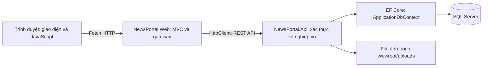
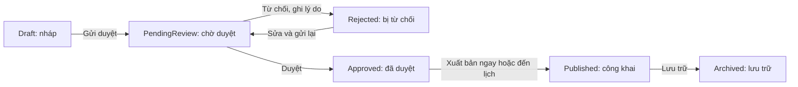

# Hướng dẫn sử dụng, thuyết trình và báo cáo NewsPortal

Tài liệu đối chiếu mã nguồn hiện tại ngày 30/09/2026. Phạm vi: bản chạy và demo trên máy này. Tên hiển thị mặc định: **Nhịp Sống**. Tin mẫu phục vụ đồ án, không phải tin thời sự thực tế.

## 1. Hiểu đề tài trong một phút

NewsPortal là website tin tức có hai khu vực:

- **Reader:** dành cho độc giả đọc, tìm kiếm, lưu bài, bình luận và tương tác.
- **CMS (Content Management System):** khu quản lý nội dung dành cho tòa soạn, có phân quyền viết bài, duyệt bài, xuất bản và quản trị.

Lời giới thiệu mẫu:

> Đề tài của em là hệ thống quản lý và xuất bản tin tức. Hệ thống mô phỏng quy trình tòa soạn: phóng viên viết bài, biên tập viên duyệt và xuất bản, độc giả đọc và tương tác. Em xây dựng giao diện bằng ASP.NET Core MVC, cung cấp nghiệp vụ qua Web API và lưu dữ liệu bằng SQL Server thông qua Entity Framework Core.

## 2. Mở và sử dụng website

### Chuẩn bị trên máy hiện tại

Mở PowerShell tại thư mục chứa `NewsPortal.sln`, chạy nếu ứng dụng chưa mở:

```powershell
powershell -NoProfile -ExecutionPolicy Bypass -File scripts/Start-Development.ps1
```

| Địa chỉ | Mục đích |
|---|---|
| http://localhost:5200 | Website độc giả |
| http://localhost:5200/dang-nhap | Đăng nhập |
| http://localhost:5200/cms | Tòa soạn CMS |
| http://localhost:5100/swagger | Xem và thử API trong môi trường development |
| http://localhost:5200/rss | Nguồn RSS của các bài đã xuất bản |
| http://localhost:5200/cong-dong | Đăng ký bản tin và bình chọn |

`localhost` là chính máy đang chạy ứng dụng. Mang sang máy khác cần cài .NET SDK 10, cấu hình SQL Server và khởi tạo theo [README](README.md); không chỉ sao chép đường dẫn website.

### Tài khoản theo vai trò

| Email demo | Vai trò | Chức năng chính |
|---|---|---|
| user@newsportal.local | User — độc giả | Đọc, bình luận, cảm xúc, lưu bài, lịch sử, hồ sơ cá nhân |
| journalist@newsportal.local | Journalist — phóng viên | Tạo và quản lý bài của mình, gửi duyệt, sử dụng thư viện ảnh |
| editor@newsportal.local | Editor — biên tập viên | Quản lý bài, duyệt/từ chối, xuất bản/lưu trữ, quản lý chuyên mục và thẻ |
| moderator@newsportal.local | Moderator — kiểm duyệt viên | Duyệt, từ chối, ẩn và xóa bình luận |
| administrator@newsportal.local | Administrator — quản trị viên | Các mục CMS, thống kê, người dùng, vai trò, cài đặt, bản tin và khảo sát |

Mật khẩu demo nằm ở trường `Password` trong `.local/development.json`. Mở riêng để đăng nhập; không đưa file chứa mật khẩu và khóa JWT lên slide hoặc vào báo cáo. Tài khoản đăng ký mới có vai trò User.

Khi đổi vai trò để demo, đăng xuất rồi đăng nhập tài khoản khác. Hai tab trong cùng hồ sơ trình duyệt dùng chung phiên đăng nhập; muốn giữ đồng thời nhiều vai trò thì dùng các hồ sơ trình duyệt riêng.

### Độc giả thao tác thế nào?

1. Mở trang chủ, chọn chuyên mục hoặc một bài viết.
2. Dùng trang tìm kiếm để tìm bài theo từ khóa; thử chuyển trang kết quả.
3. Mở chi tiết bài để xem nội dung, thẻ chủ đề và các bài liên quan.
4. Đăng nhập User để lưu bài, bày tỏ cảm xúc, gửi bình luận hoặc trả lời.
5. Xem `/da-luu`, `/lich-su`, `/thong-bao` và `/tai-khoan`.
6. Vào `/cong-dong` để đăng ký bản tin hoặc bình chọn nếu có khảo sát đang mở.

Bình luận mới cần kiểm duyệt trước khi hiển thị công khai. Đăng ký bản tin hiện lưu đăng ký, chưa gửi email tự động.

### Phóng viên tạo bài thế nào?

1. Đăng nhập Journalist → `/cms` → **Thư viện ảnh** nếu cần tải ảnh.
2. Tải JPG/JPEG, PNG hoặc WebP hợp lệ, tối đa 5 MB; sao chép đường dẫn ảnh từ thư viện.
3. Vào **Bài viết** → **Viết bài mới**.
4. Điền tiêu đề, slug, tóm tắt, nội dung và chuyên mục; chọn thẻ nếu cần. Slug là phần tên dễ đọc trong URL, ví dụ `ngay-hoi-cong-nghe-sinh-vien-01`; dùng slug chưa tồn tại.
5. Dán đường dẫn ảnh vào **Đường dẫn ảnh từ thư viện**. Nội dung là văn bản thuần.
6. Bấm **Xem trước**, sau đó **Lưu bản thảo**. Bản mới có trạng thái Draft.
7. Mở lại bài nếu đã trở về danh sách, bấm **Gửi duyệt**. Trạng thái thành PendingReview.

Ví dụ dữ liệu thực hành:

- Tiêu đề: Ngày hội công nghệ dành cho sinh viên.
- Tóm tắt: Sinh viên giới thiệu các sản phẩm công nghệ trong ngày hội của khoa.
- Nội dung: Ngày hội công nghệ là hoạt động để sinh viên trình bày sản phẩm, trao đổi kinh nghiệm và thực hành kỹ năng thuyết trình. Bài viết này là nội dung minh họa cho quy trình biên tập của đồ án.

### Biên tập viên xuất bản thế nào?

1. Đăng nhập Editor → **Bài viết** → lọc trạng thái `PendingReview` → **Lọc**.
2. Bấm **Mở** đúng bài, kiểm tra nội dung.
3. Bấm **Duyệt bài** để chuyển thành Approved; sau đó **Xuất bản ngay** để thành Published.
4. Nếu nội dung cần sửa, chọn **Từ chối** và nhập lý do. Phóng viên sửa rồi gửi duyệt lại.
5. Muốn hẹn giờ: khi bài còn PendingReview, nhập **Lịch xuất bản sau khi duyệt (tùy chọn)** ở thời điểm tương lai, rồi bấm **Duyệt bài**. Không cần bấm xuất bản ngay.
6. Về trang độc giả, tải lại hoặc tìm theo tiêu đề để kiểm tra bài đã xuất hiện.

Bộ xử lý nền kiểm tra lịch khoảng mỗi 30 giây khi API đang chạy. Vì vậy bài có thể xuất hiện sau giờ hẹn một khoảng ngắn; nếu API dừng thì lịch không được xử lý cho tới khi API chạy lại. Trình duyệt đang mở không tự nhận bài mới tức thời, cần tải lại dữ liệu/trang.

### Kiểm duyệt và quản trị

- Moderator: CMS → **Kiểm duyệt bình luận** → tìm bình luận vừa gửi → **Duyệt**, **Từ chối** hoặc **Ẩn**.
- Administrator: xem **Tổng quan**, **Người dùng**, **Cài đặt**, **Đăng ký bản tin**, **Khảo sát** và các mục nội dung.
- Editor/Administrator: quản lý **Chuyên mục**, **Thẻ chủ đề**. Chuyên mục là nhóm chính, thẻ mô tả nhiều chủ đề của một bài.
- Thực hành thay đổi/xóa bằng dữ liệu demo riêng; bài ở chuyên mục không hoạt động sẽ không hiện công khai.

## 3. Website hoạt động bên trong như thế nào?



**Trình duyệt** hiển thị trang và gửi yêu cầu khi người dùng bấm nút. **Web** cung cấp giao diện MVC và chuyển yêu cầu qua `/gateway`. **API** kiểm tra dữ liệu, quyền và quy tắc nghiệp vụ. **EF Core** ánh xạ đối tượng C# với bảng và thực hiện truy vấn SQL Server. Kết quả đi ngược về giao diện, thường dưới dạng JSON.

Ví dụ khi tìm bài:

1. Người dùng nhập từ khóa trên giao diện.
2. JavaScript gọi `/gateway/articles` kèm tham số tìm kiếm/phân trang.
3. Web dùng `PortalApiClient` gọi `/api/v1/articles` ở API.
4. `ArticleService` lọc bài Published thuộc chuyên mục đang hoạt động, áp dụng điều kiện và phân trang.
5. EF Core truy vấn SQL Server; API trả dữ liệu JSON và thông tin trang.
6. JavaScript dựng danh sách bài trên màn hình.

Lời giải thích mẫu:

> Giao diện không truy cập cơ sở dữ liệu trực tiếp. Mọi thao tác dữ liệu được gửi qua API. Cách tách này giúp tập trung quy tắc nghiệp vụ và kiểm soát quyền ở phía máy chủ, đồng thời cho phép phát triển thêm giao diện khác sử dụng API.

### Đăng nhập và phân quyền

Identity quản lý tài khoản và mật khẩu đã băm. Khi đăng nhập thành công, API cấp JWT. Web lưu JWT trong vé xác thực được bảo vệ bằng cookie HttpOnly; JavaScript không nhận JWT trong kết quả đăng nhập và không lưu nó vào localStorage. Web lấy token để gọi API bằng Bearer.

API kiểm tra token và vai trò, đồng thời kiểm tra quyền sở hữu khi cần. Việc giấu nút trên giao diện chỉ hỗ trợ trải nghiệm; kiểm tra quyền thực sự nằm ở API. Các thao tác thay đổi dữ liệu qua gateway có kiểm tra antiforgery token để chống CSRF.

### Quy trình bài viết



Approved chưa đồng nghĩa với Published. Bài chỉ hiện với độc giả khi Published và chuyên mục đang hoạt động. Hẹn giờ là xuất bản nội dung đã có trong hệ thống, không phải tự thu thập tin từ Internet.

## 4. Cấu trúc mã nguồn: cần mở file nào khi thầy hỏi?

```text
NewsPortal/
├── NewsPortal.Api/              Máy chủ dữ liệu và nghiệp vụ
│   ├── Controllers/             Các endpoint HTTP
│   ├── Services/                Bài viết, biên tập, lịch xuất bản, xác thực, cache
│   ├── Models/                  Entity: đối tượng được lưu trong database
│   ├── DTOs/                    Kiểu dữ liệu nhận/trả qua API
│   ├── Data/                    DbContext, cấu hình quan hệ, dữ liệu mẫu
│   ├── Migrations/              Lịch sử thay đổi cấu trúc database
│   ├── Middleware/              Xử lý lỗi, audit, cache filter
│   ├── Documentation/           Mô tả Swagger
│   └── Program.cs               Đăng ký dịch vụ và cấu hình ứng dụng
├── NewsPortal.Web/              Giao diện và kết nối tới API
│   ├── Controllers/             Trang, gateway, RSS/sitemap
│   ├── Services/PortalApiClient.cs
│   ├── Views/                   Razor: khung HTML của giao diện
│   ├── wwwroot/js/              portal.js, cms.js, community.js
│   ├── wwwroot/css/             Giao diện và responsive
│   └── Program.cs               Cookie, HttpClient và middleware của Web
├── NewsPortal.Tests/            Kiểm thử tự động
├── scripts/                    Khởi tạo, chạy, dừng và kiểm chứng demo
└── Các file .md                 Tài liệu thiết kế, API và kiểm thử
```

| Câu hỏi | Nơi xem |
|---|---|
| Lọc và phân trang bài ở đâu? | `NewsPortal.Api/Services/ArticleService.cs` |
| Ai được duyệt, chuyển trạng thái ra sao? | `NewsPortal.Api/Services/EditorialService.cs` |
| Hẹn giờ chạy thế nào? | `NewsPortal.Api/Services/ScheduledPublisher.cs` |
| Quan hệ database khai báo ở đâu? | `NewsPortal.Api/Data/ApplicationDbContext.cs`, `Models/` |
| Giao diện gọi API thế nào? | `NewsPortal.Web/Controllers/ApiProxyController.cs`, `Services/PortalApiClient.cs` |
| Form viết bài và nút CMS ở đâu? | `NewsPortal.Web/wwwroot/js/cms.js` |

Không gọi dự án là microservices hoặc khẳng định dùng Clean Architecture đầy đủ. Mô tả sát mã nguồn là **ứng dụng Web và API tách riêng, API tổ chức theo controller, service và lớp truy cập dữ liệu EF Core**. Một số controller làm việc trực tiếp với DbContext, không phải mọi endpoint đều đi qua service riêng.

## 5. Cơ sở dữ liệu cần hiểu

| Nhóm bảng | Vai trò và quan hệ |
|---|---|
| AspNetUsers, AspNetRoles, AspNetUserRoles | Tài khoản, vai trò và liên kết giữa chúng |
| Categories → Articles | Một chuyên mục có nhiều bài; một bài thuộc một chuyên mục |
| Articles ↔ ArticleTags ↔ Tags | Bài và thẻ quan hệ nhiều–nhiều qua bảng trung gian |
| Articles → Comments | Một bài có nhiều bình luận; ParentCommentId hỗ trợ trả lời |
| Bookmarks, ArticleReactions, ReadingHistories | Lưu bài, cảm xúc, lịch sử theo người dùng và bài |
| Media | Thông tin file ảnh; file thật lưu trong thư mục uploads |
| ArticleRevisions | Bản lưu lịch sử nội dung khi chỉnh sửa |
| Notifications, AuditLogs | Thông báo người dùng và ghi nhận thao tác |
| SiteSettings | Cấu hình tên website, chân trang |
| NewsletterSubscribers | Danh sách đăng ký bản tin |
| Polls, PollOptions, PollVotes | Khảo sát, lựa chọn và phiếu bình chọn |

Khóa chính định danh bản ghi; khóa ngoại liên kết các bảng. Slug có ràng buộc duy nhất. `RowVersion` giúp phát hiện hai người sửa cùng một phiên bản: người lưu sau nhận lỗi xung đột thay vì âm thầm ghi đè. Migration tạo/cập nhật cấu trúc bảng từ mô hình C#; seed thêm dữ liệu mẫu. ERD chi tiết có trong [DATABASE_DESIGN.md](DATABASE_DESIGN.md).

## 6. Kịch bản thuyết trình và demo khoảng 10–12 phút

| Thời gian | Thao tác / nội dung | Câu nói gợi ý |
|---|---|---|
| 0–1 phút | Giới thiệu đề tài và trang chủ | Hệ thống phục vụ độc giả và quản lý quy trình tòa soạn. |
| 1–2 phút | Chuyên mục, tìm kiếm, chi tiết bài | Độc giả có thể tìm nội dung theo từ khóa, chuyên mục và thẻ. |
| 2–4 phút | Journalist tạo bản nháp, xem trước, gửi duyệt | Phóng viên quản lý bài của mình, chưa tự đưa bài ra công khai. |
| 4–5 phút | Editor duyệt rồi xuất bản | Hệ thống tách bước duyệt và xuất bản; có thể hẹn giờ. |
| 5–6 phút | Tìm bài vừa đăng, User lưu và bình luận | Bài đã xuất bản xuất hiện ở khu vực độc giả. |
| 6–7 phút | Moderator duyệt bình luận | Nội dung bình luận được kiểm duyệt trước khi công khai. |
| 7–8 phút | Administrator xem tổng quan và người dùng | Hệ thống phân quyền theo nhiệm vụ của từng tài khoản. |
| 8–10 phút | Sơ đồ kiến trúc, thư mục và database | Web gọi API qua HTTP; API dùng EF Core làm việc với SQL Server. |
| 10–12 phút | Swagger, bằng chứng kiểm thử, phạm vi hoàn thành | Trình bày kết quả đã ghi nhận và các giới hạn thực tế. |

Trước buổi trình bày, thử toàn bộ một lần, chuẩn bị ảnh hợp lệ và nội dung bài ở trên. Khi thời gian ngắn, ưu tiên luồng viết → duyệt → xuất bản → đọc. Có thể giới thiệu hẹn giờ bằng mã nguồn thay vì chờ trực tiếp. Không cần chạy lại toàn bộ kiểm thử cài mới trong giờ demo.

## 7. Dàn ý báo cáo và slide

### Báo cáo viết

1. **Giới thiệu:** lý do chọn đề tài, mục tiêu, phạm vi bản local.
2. **Phân tích yêu cầu:** các vai trò, chức năng, quy trình duyệt, yêu cầu trong TXT; tham khảo `REQUIREMENTS_TRACEABILITY.md`.
3. **Thiết kế:** sơ đồ kiến trúc, ERD, trạng thái bài, API và phân quyền.
4. **Cài đặt:** cấu trúc project, cấu hình môi trường, mô tả các màn hình và các luồng chính.
5. **Kiểm thử:** tình huống, kết quả mong đợi/thực tế, ảnh minh chứng, kết quả tự động.
6. **Kết quả và hướng phát triển:** chức năng đã hoàn thành; hosting công khai, gửi email và cập nhật tức thời là các hướng tiếp theo nếu cần.

Ảnh nên chụp: trang chủ; tìm kiếm; bài chi tiết; form bản nháp; bài chờ duyệt; bài đã xuất bản; kiểm duyệt bình luận; quản trị người dùng; Swagger; kết quả kiểm thử. Chú thích mỗi ảnh bằng thao tác và ý nghĩa, tránh chỉ ghép ảnh không giải thích.

### Bộ slide đề xuất

| Slide | Nội dung |
|---|---|
| 1 | Tên đề tài, thông tin sinh viên/nhóm |
| 2 | Bài toán, mục tiêu, phạm vi |
| 3 | Năm vai trò và chức năng |
| 4 | Kiến trúc Web → API → EF Core → SQL Server |
| 5 | ERD và các quan hệ chính |
| 6 | Quy trình trạng thái bài |
| 7 | Demo trực tiếp luồng chính |
| 8 | Xác thực, phân quyền, validation, RowVersion |
| 9 | Bằng chứng kiểm thử |
| 10 | Kết quả, giới hạn và hướng phát triển |

## 8. Câu hỏi thường gặp khi bảo vệ

**Tin tức lấy từ đâu? Có tự cập nhật không?**

Phóng viên nhập nội dung vào CMS, biên tập viên duyệt và xuất bản. Hệ thống tự xuất bản bài đã duyệt khi đến lịch. Không có chức năng tự lấy tin từ báo ngoài; trang độc giả cần tải lại để nhận nội dung mới.

**RSS có phải lấy tin từ trang khác không?**

RSS hiện cung cấp danh sách bài công khai của chính website cho ứng dụng đọc RSS. Đây là xuất dữ liệu, không phải nhập tin từ nguồn ngoài.

**Tại sao cần cả Web và API?**

Web chịu trách nhiệm giao diện; API xử lý dữ liệu và kiểm soát nghiệp vụ. Nhờ tách qua HTTP, có thể kiểm thử API độc lập và xây dựng thêm ứng dụng dùng chung API.

**MVC và API khác nhau thế nào trong dự án này?**

MVC trả khung trang HTML và có gateway. API chủ yếu nhận/trả JSON, thực hiện các thao tác nghiệp vụ. JavaScript trên trang dùng Fetch để cập nhật phần nội dung qua gateway.

**DTO khác Entity thế nào?**

Entity mô tả dữ liệu lưu trong database. DTO quy định những trường client được gửi hoặc nhận, giúp không đưa toàn bộ cấu trúc nội bộ ra API.

**Chặn quyền bằng cách ẩn nút có đủ không?**

Không. API kiểm tra xác thực, vai trò và quyền sở hữu. Gọi trực tiếp API vẫn bị từ chối nếu không đủ quyền.

**401, 403, 409 có nghĩa gì?**

401 là chưa xác thực hợp lệ; 403 là không đủ quyền; 409 là xung đột dữ liệu hoặc trạng thái. Dữ liệu nhập không hợp lệ thường trả 400; tài nguyên không tìm thấy trả 404.

**Hai người cùng sửa bài thì sao?**

Mỗi lần chỉnh sửa gửi RowVersion của bản đã đọc. Nếu dữ liệu đã thay đổi, hệ thống trả 409; người dùng cần tải lại và đối chiếu thay đổi trước khi lưu lại.

**Tìm kiếm và phân trang ở đâu?**

Thực hiện phía API/database. API áp dụng điều kiện lọc, sắp xếp, Skip/Take và trả dữ liệu trang cùng tổng số bản ghi; không tải toàn bộ bài về trình duyệt để phân trang.

**Ảnh được lưu trong database không?**

File ảnh lưu ở `NewsPortal.Api/wwwroot/uploads`; bảng Media lưu đường dẫn, kích thước, loại file và người tải lên. API kiểm tra định dạng, MIME, chữ ký file và dung lượng.

**Hệ thống có chống mọi cuộc tấn công không?**

Có các biện pháp cụ thể: kiểm tra quyền, CSRF, hiển thị nội dung dưới dạng văn bản được escape, kiểm tra file và bảo vệ cookie. Không tuyên bố an toàn tuyệt đối hoặc đã kiểm thử xâm nhập toàn diện.

**Đã kiểm thử những gì? Có đạt 100% không?**

Theo lần nghiệm thu ghi trong `ACCEPTANCE_REPORT.md`: 21 kiểm thử gồm 20 HTTP/SQL và 1 unit cache đều đạt; thêm 8 trường hợp kiểm tra giao diện cơ bản, 26 mốc kiểm tra luồng thao tác và 3 kiểm tra CORS/mất kết nối/phục hồi đều đạt. Đây là kết quả của bộ kiểm thử đã thực hiện, không phải 100% độ bao phủ mã nguồn hoặc đảm bảo không bao giờ có lỗi. Tài liệu này không chạy lại các kiểm thử đó.

**Đã triển khai thực tế chưa?**

Đã chạy và kiểm chứng bản publish trên máy local, có kiểm tra cài mới ứng dụng/database trên máy này. Chưa triển khai hosting/IIS công khai. Newsletter chưa gửi email tự động; nội dung bài hiện là văn bản thuần; không có crawler hoặc cập nhật tức thời qua WebSocket/SignalR.

## 9. Tài liệu dùng làm căn cứ

- [README](README.md): khởi chạy và kiến trúc tổng quan.
- [API_DOCUMENTATION.md](API_DOCUMENTATION.md): endpoint và quyền truy cập.
- [DATABASE_DESIGN.md](DATABASE_DESIGN.md): bảng, cột và ERD.
- [REQUIREMENTS_TRACEABILITY.md](REQUIREMENTS_TRACEABILITY.md): đối chiếu TXT với phần đã làm.
- [ACCEPTANCE_REPORT.md](ACCEPTANCE_REPORT.md): phạm vi và chứng cứ kiểm thử.
- [DEMO_SCRIPT.md](DEMO_SCRIPT.md): các tình huống demo kỹ thuật bổ sung.

Khi viết báo cáo, diễn đạt theo những phần bạn đã hiểu và tự thao tác được; dùng ví dụ demo để giải thích thay vì chỉ đọc tên công nghệ.
